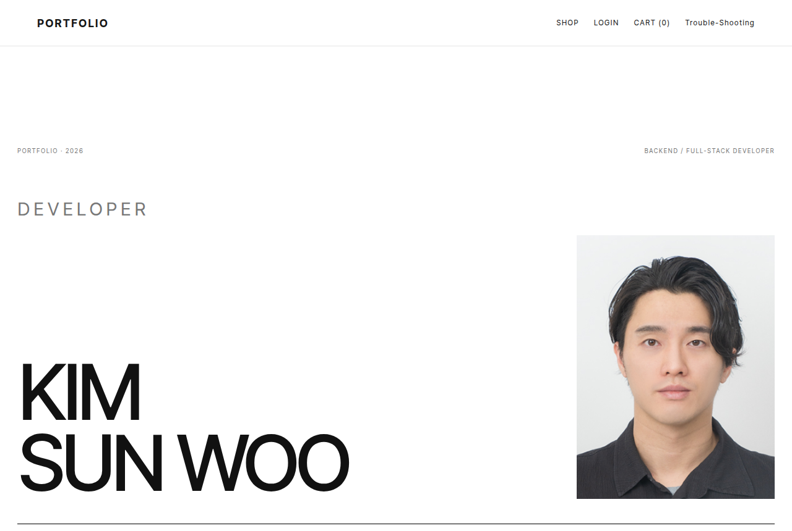
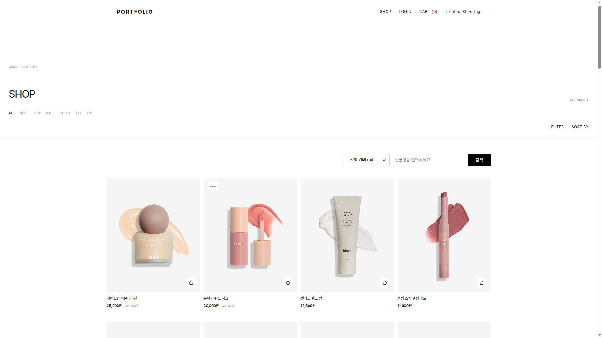
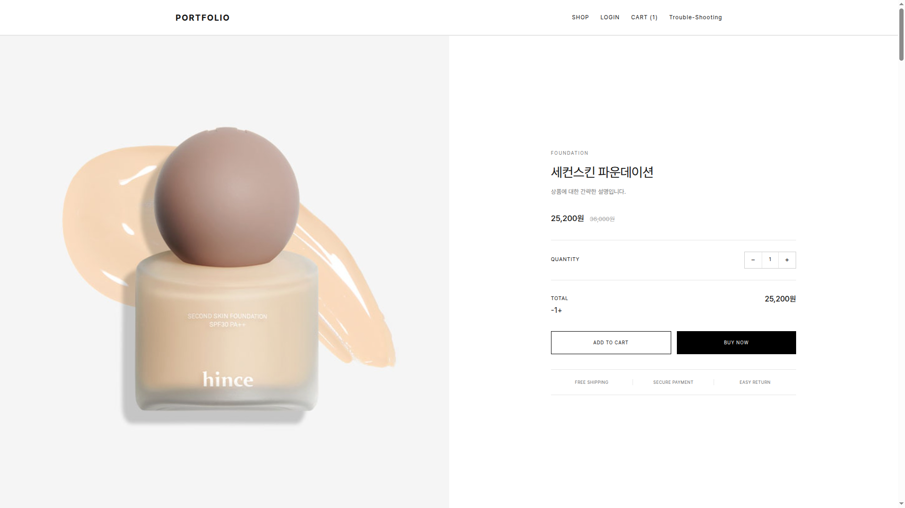
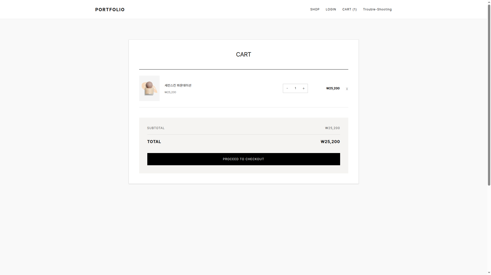

# 콘텐츠를 보여주고, 장바구니와 테스트 결제로 상태를 맞춰 본 서비스

방문자가 경력·프로젝트·글을 읽고, 상품을 담아 보고, 관리자가 그 데이터를 고치는 개인 프로젝트입니다. 상품·장바구니·100원 테스트 결제는 이커머스 회사를 위한 제품이 아니라, 인증·소유권·재전송·캐시를 코드로 확인해 본 모듈입니다.
관리자 아이디 : test@test.com 비밀번호 : test147@

## 서비스 소개

사용하는 사람은 세 종류입니다.

- 방문자는 홈, 프로젝트, 커뮤니티, 상품 목록과 상세를 로그인 없이 봅니다.
- 회원은 비회원 장바구니를 서버 장바구니와 합치고, 100원 승인 뒤 자동 취소되는 테스트 결제를 진행합니다.
- 관리자는 이력·프로젝트·상품을 수정하고, 구매 분석 화면을 봅니다. 분석 API는 관리자 권한이 필요합니다.

주요 흐름은 공개 조회, 브라우저 로컬 장바구니, 로그인 후 한 번의 병합, 테스트 결제입니다. 결제 성공이 구매 분석 테이블을 채우지는 않습니다. 그 구분은 [구현 범위](#구현-범위검증한계)에 있습니다.

## 대표 화면과 실행 링크

공개 사이트는 [https://swportfolioservices.com](https://swportfolioservices.com)입니다. 2026-10-29에 `/`, `/shop`, `/admin/shop`이 HTTP 200이었습니다. 이것은 페이지가 응답했다는 확인이고, 관리자 데이터나 결제까지 동작했다는 뜻은 아닙니다.

| 화면 | 경로 |
| --- | --- |
| 홈 | [/](https://swportfolioservices.com/) |
| 상품 | [/shop](https://swportfolioservices.com/shop) |
| 커뮤니티 | [/community](https://swportfolioservices.com/community) |
| 로그인 | [/login](https://swportfolioservices.com/login) |
| 관리자 상품 | [/admin/shop](https://swportfolioservices.com/admin/shop) |

관리자 화면 주소는 열려 있어도 상품·이력·구매 분석 API는 관리자 Access Token이 있어야 합니다. 계정과 비밀번호는 이 저장소에 없습니다.

저장소에 있는 화면 캡처:






## 구현 범위와 개발 방식

이 저장소에서 다룬 범위는 Spring Boot API, Next.js 화면, MySQL 스키마와 Flyway, Redis 캐시, Docker 이미지, GitHub Actions와 배포 스크립트입니다. 기능 구현과 리팩터링에는 Cursor를 썼고, 요구의 범위와 테스트로 결과를 걸러 냈습니다. 저장소의 모든 줄을 한 사람이 처음부터 손으로만 썼다거나, 이 서비스를 실무 운영 환경으로 맡았다고 보지 않습니다.

개인 프로젝트에서 문제를 정의하고, AI로 만든 구현을 검토·수정하고, 실패 상황을 테스트로 확인했습니다. 그 경험은 실무 코드와 운영 기준을 읽고 맞추기 위한 기반입니다. 즉시 대규모 운영을 맡을 수 있다거나, 장애가 무손실로 복구된다고 말하지 않습니다.

## 핵심 문제 해결

### 장바구니 병합의 멱등성

수정 전에는 완료 기록이 프로세스 메모리에 있었고, DB 커밋 전에 그 기록을 넣으면 실패한 재시도를 건너뛸 수 있었습니다. 빈 장바구니는 조회에서 빠지기도 했습니다.

같은 병합을 새로고침하거나 응답을 못 받고 다시 보내면 수량이 두 번 더해집니다. 사용자는 담은 개수와 다른 장바구니를 봅니다.

원인은 재전송과 첫 요청을 구분하지 못한 것입니다. 메모리 잠금만 쓰면 재시작과 다른 인스턴스를 넘지 못합니다.

검토한 방법은 클라이언트만 막는 방법, 메모리 잠금, DB UNIQUE였습니다. 재시작 뒤에도 같은 요청을 한 번만 반영하려면 병합과 완료 기록이 같은 트랜잭션이어야 해서 DB UNIQUE를 골랐습니다.

구현은 `cart_sync_requests`의 사용자, 작업 종류, 요청 키 UNIQUE입니다. 본문 해시는 정렬한 `상품:수량` 또는 `상품:색상:수량`의 SHA-256입니다. 같은 키와 같은 해시는 수량을 다시 더하지 않고, 같은 키의 다른 해시는 409입니다. 키가 없으면 매번 더합니다. 합이 99를 넘는 줄이 있으면 그 병합 전체를 롤백해서 일부만 반영하지 않습니다. 색이 없는 줄과 다른 색은 다른 줄입니다. 일반 옵션 모델은 아닙니다. 프런트는 같은 fingerprint의 재시도에 sessionStorage의 같은 키를 쓰고, 성공한 뒤에만 그 키를 지웁니다. 실패하면 로컬 장바구니는 지우는 코드 경로에 들어가지 않습니다.

막는 테스트는 `CartSyncMySqlTest`입니다. 같은 키의 재전송과 새 서비스 인스턴스, 동시 요청 한 번 반영, 상한 초과 롤백 후 수량 조정 재시도, 다른 본문 409, 다른 사용자 거부입니다. 프런트 키 재사용은 `frontend/src/lib/authSession.test.mts`입니다. 운영 DB에 테이블이 생긴 시점과 화면에서 다시 누른 동작은 이 테스트와 별개입니다.

한계는 키를 보내지 않으면 재전송을 막지 못한다는 점과, 성공 응답을 받은 뒤 로컬 삭제가 실패하는 경우까지 한 트랜잭션으로 묶지 않았다는 점입니다.

### 인증 복구와 로그아웃 경쟁

수정 전에는 만료 Access Token으로 장바구니를 호출하면 갱신 없이 실패하거나, 로그인 사용자를 비회원 장바구니로 내릴 수 있었습니다. 늦은 Refresh가 로그아웃 뒤에 세션을 다시 만들 여지도 있었습니다.

로그아웃을 누르는 동안 갱신 응답이 도착하면, 사용자는 나간 뒤에도 로그인 상태로 보일 수 있습니다. 쿠키가 남아 있으면 서버가 이미 버린 세션과 브라우저 표시가 달라집니다.

원인은 요청마다 따로 갱신하고, Refresh 폐기와 브라우저 상태를 한 세대로 맞추지 못한 것입니다.

검토한 방법은 Access Token 즉시 폐기 목록과, Refresh만 세대 번호로 버리는 방법이었습니다. Access를 서버에 저장하면 요청마다 조회가 필요해서, Refresh와 DB 세대만 폐기하고 Access는 만료까지 두었습니다. 그 선택을 완전한 즉시 로그아웃이라고 부르지 않습니다.

구현은 프런트의 `authGeneration`입니다. 로그아웃이 세대를 올리면 그 전에 시작한 Refresh 결과는 버립니다. 갱신 Promise는 하나이고, 403에는 다시 갱신하지 않습니다. 변경 요청은 인증 실패 뒤 자동으로 다시 보내지 않습니다. 서버는 `users.session_epoch`를 올리고 Redis의 현재 세션과 10초 유예를 지웁니다. Redis 삭제가 실패해도 올라간 세대의 Refresh는 거절되며, 그 결과를 로그아웃 완료로 반환하지 않습니다. 쿠키가 있어도 세대나 세션이 다르면 Refresh는 거절됩니다. Access Token 유효 시간은 코드에서 30분입니다. `jwt.expiration=86400000` 설정은 이 발급 코드가 읽지 않습니다.

단위·통합 테스트는 `SessionLifecycleMySqlTest`의 로그아웃과 Refresh 경쟁, Redis 정리 실패 뒤에도 Refresh 거부, `RefreshSessionRedisTest`의 유예와 폐기, `authSession.test.mts`의 늦은 Refresh와 비회원 장바구니 오인 방지입니다. 이 조사에서 실제 브라우저로 로그아웃 클릭을 다시 하지는 않았습니다.

한계는 이미 발급된 Access Token이 만료 전까지 관리자 API를 포함한 인증 API에 쓰인다는 점입니다. 롤백한 구버전이 `session_epoch`를 보지 않으면 그 인스턴스의 Refresh 폐기는 달라집니다. 구버전 이미지를 이 조사에서 다시 실행하지는 않았습니다.

### 배포 실패와 복구

2026-10-13 Actions 배포는 새 백엔드의 준비 검사에서 실패했고, 스크립트는 backend 단계에서 롤백했습니다. 기록은 [docs/incidents/2026-10-13-backend-readiness.md](docs/incidents/2026-10-13-backend-readiness.md)입니다. 운영 장애를 현장에서 복구했다기보다, 실패한 배포 실행과 셸로 재현한 실패 조건을 나눠 적습니다. 당시 Actions 로그 본문과 EC2 컨테이너 로그는 읽지 못했습니다.

사용자 영향은 그 실행이 프런트 교체 전에 끝나, 공개 프런트가 그 실패 이미지로 바뀌지는 않았다는 기록입니다. 프런트를 바꾸는 배포는 호스트 3000을 잠시 비웁니다.

원인은 `ddl-auto=validate`인데 `cart_sync_requests`가 운영 DB에 없던 상태로 보는 것이 채택된 설명입니다. 보존 컨테이너 스택트레이스는 없습니다.

검토한 복구는 실패 컨테이너를 지우는 방법과, 멈추고 이름을 바꾼 뒤 이전 컨테이너를 다시 켜는 방법이었습니다. 원인을 남기려고 실패 컨테이너를 보존합니다.

구현은 `deploy.sh`입니다. 새 백엔드 준비 실패는 그 컨테이너를 멈추고 `portfolio-backend-*-failed-<시각>`으로 남깁니다. 이전 백엔드를 이미 멈춘 단계라면 다시 시작합니다. Nginx를 바꾼 뒤의 실패는 백업의 `restore.sh`로 manifest를 되돌립니다. 프런트를 바꾼 뒤라면 이전 프런트 컨테이너 이름으로 되돌립니다. 복구 명령이 실패하면 컨테이너와 백업을 남기고 자동 복구 완료로 보지 않습니다. 이미지 태그는 커밋 SHA이고 `latest`로 배포하지 않습니다.

셸 mock `ops/tests/run-deploy-checks.sh`가 재현하는 조건은 이미지 pull 실패, 백엔드·프런트 준비 실패, Nginx 검사 실패, 공개 확인 실패, 이전 컨테이너를 멈춘 뒤의 실패, 사용 중인 컨테이너 보존, 잘못된 포트, 슬롯과 어긋난 Nginx, `latest` 거부, 배포 잠금, 백업이 Nginx 밖인 경우, 릴리스 경로, manifest 복구, 컨테이너가 없을 때의 복구입니다. 이것은 로컬 가짜 docker와 파일입니다. EC2에서 같은 실패를 다시 만들지는 않았습니다.

2026-10-29 `3226b10`의 Actions [40869105357](https://github.com/KimSunWooo/portfolio/actions/runs/40869105357)은 `deploy`까지 성공했습니다. 그 성공이 위 장애의 재현이나 운영 데이터 정합까지 확인한 것은 아닙니다.

한계는 DB 마이그레이션을 배포 롤백이 되돌리지 않는다는 점, 구버전과 신버전의 `session_epoch` 검사가 다를 수 있다는 점, 그리고 프런트 한 포트 교체 중 짧은 중단입니다.

## 아키텍처와 기술 선택

```text
브라우저
  Next.js 페이지, 로컬 장바구니, Access Token 메모리, Refresh 쿠키
        |  NEXT_PUBLIC_API_URL
        v
Next.js 서버  SSR은 INTERNAL_API_URL. 브라우저의 localhost와 같지 않다
        |
        v
Spring Boot  Security, 장바구니, 결제, 선택적 메시징
        |                 \
        v                  v
MySQL  Redis 캐시          RabbitMQ, Kafka
                           기본값은 꺼짐
```

백엔드는 Java 21, Spring Boot, Spring Security, JPA, MySQL입니다. 프런트는 Next.js App Router, React, TypeScript입니다. 상품 목록만 Redis 캐시입니다. TTL 10분, null 캐시 없음, 문자열 키, `GenericJackson2JsonRedisSerializer`와 `JavaTimeModule`은 `RedisConfig`에 있습니다. 상품 상세 조회는 이 캐시를 쓰지 않습니다.

RabbitMQ와 Kafka는 선택 구성입니다. 설정 파일의 기본값은 둘 다 꺼져 있고, 운영에서 켜져 있는지는 확인하지 않았습니다. S3와 메일, 결제 키는 환경변수입니다. 운영 DB는 RDS와 `ddl-auto=validate`이고, 운영 프로파일만 Flyway를 켭니다.

## 구현 범위·검증·한계

대조표와 구매 분석·메시징의 범위는 [docs/implementation-scope.md](docs/implementation-scope.md)에 있습니다.

구매 분석은 DB에서 구매 기록 행을 읽고 서버에서 집계합니다. SQL `GROUP BY`로 합계를 만들지 않습니다. 결제 성공이 `purchase_orders`로 넘어가는 연계는 없습니다. DEMO 시드와 LIVE 결제는 `record_source`로 구분합니다. 시드 건수와 금액은 `backend/scripts/seed-demo-purchases.sh`와 `PurchaseAnalyticsMySqlTest`를 봅니다.

RabbitMQ는 비밀번호 변경 알림입니다. 변경과 Outbox 기록은 한 트랜잭션이고, 큐 발행과 메일 발송은 그 다음입니다. `PUBLISHED`는 메일 도착이 아닙니다. Kafka는 백엔드 상품 상세 조회 성공 이벤트입니다. 발행 코드는 `Future.get`으로 최대 1초를 기다립니다. 이 대기와 프로듀서 `max.block.ms=200`을 더한 값을 호출 전체의 최대 시간으로 단정하지 않습니다. 현재 규모에서 브로커가 필수였다고 보지 않습니다. 실패와 중복을 시험한 구성이고, 브로커를 켜면 운영 대상이 늘어납니다.

캐시 전후 138ms와 21ms는 측정 원본이 없어 결과로 쓰지 않습니다. 2026-10-29에 격리된 verify MySQL과 Redis, SALE 상품 51개, `GET /api/products`로 다시 재었습니다. 원본은 [ops/perf/2026-10-29-product-list.json](ops/perf/2026-10-29-product-list.json)입니다. JVM을 한 번 깨운 뒤 캐시 키를 지운 요청은 12.16ms와 8.35ms, 바로 다음 요청은 3.28ms와 3.03ms였고 응답 SHA-256은 같았습니다. MySQL `Questions`는 그 요청 동안 10과 4로, 히트에서도 0이 아니었습니다. 이어서 한 프로세스에서 순차 100회는 오류 0, p50 1.34ms, p95 1.65ms였습니다. k6 가상 사용자 50명 조건이 아니고 공개 서버를 치지 않았습니다. 이 차이만으로 운영 성능이 좋아졌다고 단정하지 않습니다.

같은 날 캐시를 끈 상태와 목록 캐시를 워밍한 상태를 10 VU, 30초, 요청 간 0.5초로 세 번씩 교차해 관측했습니다. 이 비교의 격리 데이터는 SALE 54개로 앞의 51개와 다릅니다. 워밍된 회차의 측정 구간에서는 상품 목록 SELECT가 없었고, 지연은 캐시를 끈 회차보다 낮았습니다. 처리량에는 대기가 포함되어 있어 최대 처리 능력이 아닙니다. 회차 값은 [ops/perf/2026-10-29-cache-ab/summary.json](ops/perf/2026-10-29-cache-ab/summary.json)에 있습니다. 캐시를 끈 회차의 digest SELECT는 594, 595, 591이었습니다. 이 값을 요청 600회로 다시 채우지 않습니다.

2026-10-30에 계측만 따로 확인했습니다. 운영 기본값에서는 꺼 둔 카운터로, 캐시를 끈 순차 20회는 HTTP 진입·서비스 진입·상품 목록 SELECT·digest가 모두 20이었습니다. 같은 부하의 동시 요청 한 번은 애플리케이션 카운터가 600, 600, 600이고 digest는 550이었습니다. `Performance_schema_digest_lost`는 0이었습니다. 이 동시 구간은 문 검사기가 켜진 JVM이라 앞의 지연 비교를 대체하지 않습니다. 원본은 로컬 `ops/perf/2026-10-30-sql-gap/probe.json`이며 원격 커밋에는 없습니다.

`frontend/src/lib/api.ts`는 인증, 상품, 장바구니, 관리자, 커뮤니티, 구매 분석이 한 파일에 있습니다. Refresh Promise와 `authGeneration`의 소유가 하나여야 해서, 이번 문서 정리와 파일 분리를 섞지 않았습니다. 분리한다면 `api.ts`에서 다시보내 호출부를 유지해야 합니다.

테스트가 막는 범위는 위 세 사례와 `PaymentServiceTest`의 승인 전 `DONE` 금지, 같은 프로세스의 중복 승인, 취소 실패입니다. `./gradlew test`와 Actions 성공을 운영 기능 활성화의 증거로 쓰지 않습니다.

기준 커밋은 `3226b1061dcac92bf1fc093a97a4ed5fe15fbc1a`입니다. 그 Actions 실행은 다섯 job이 성공했습니다. 배포 job 성공과 개별 기능의 운영 활성은 다릅니다.

## 빠른 로컬 실행

개인 `.env`는 만들지 않고, 있어도 덮어쓰지 않습니다. 이름만 있는 예시는 [`.env.example`](.env.example)입니다. 비밀번호와 운영 호스트는 넣지 않았습니다.

격리된 MySQL과 Redis:

```bash
docker compose -f compose.verify.yml up -d
cd backend && ./gradlew bootRun --args='--spring.profiles.active=verify'
```

verify 프로파일은 127.0.0.1:3307과 6380을 쓰고 Flyway로 빈 DB를 만듭니다. RabbitMQ와 Kafka는 꺼져 있습니다. 데이터소스나 `JWT_SECRET` 없이 기본 설정만으로 띄우면 기동에 필요한 값이 없어 실패합니다. 그 경우 verify 프로파일을 사용합니다.

프런트:

```bash
cd frontend && npm ci && npm run dev
```

브라우저 API는 `NEXT_PUBLIC_API_URL`, 서버 렌더는 `INTERNAL_API_URL`입니다. 기본값은 `http://localhost:8080`입니다.

메시징을 보려면 `docker compose -f compose.messaging.yml up -d` 뒤에 `.env.example`의 `RABBITMQ_*`, `KAFKA_*`와 두 `enabled` 플래그를 켭니다. 기본 실행에는 필요 없습니다.

시연 구매 기록은 앱이 자동으로 넣지 않습니다. verify MySQL이 떠 있을 때 `backend/scripts/seed-demo-purchases.sh`와 `clear-demo-purchases.sh`를 사용합니다. 대량 배치는 `seed-bulk-demo-purchases.sh`와 `clear-bulk-demo-purchases.sh`입니다. LIVE 행은 지우지 않습니다.

로컬 관리자는 가입 뒤 DB에서 해당 사용자 역할을 `ROLE_ADMIN`으로 바꿉니다. 비밀번호를 저장소나 문서에 적지 않습니다.

확인 명령:

```bash
cd backend && ./gradlew test --no-daemon
cd frontend && npm run lint && npm run typecheck && npm test && npm run build
bash ops/tests/run-deploy-checks.sh
python3 ops/perf/compare-product-list.py --base-url http://127.0.0.1:18080
```

마지막 명령은 로컬에 상품 목록 API가 떠 있을 때만 의미가 있습니다.

콘텐츠 초안·이력은 스키마에 없습니다. 이유는 [docs/follow-up-content-workflow.md](docs/follow-up-content-workflow.md)에 있습니다. 자동매매 소개 원본은 [docs/projects/auto-trading-project.json](docs/projects/auto-trading-project.json)입니다.

저장소: [https://github.com/KimSunWooo/portfolio](https://github.com/KimSunWooo/portfolio)
