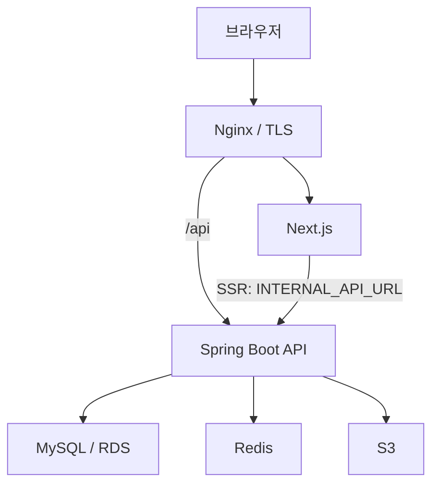

# 인증·장바구니 정합성과 배포 복구를 구현한 풀스택 웹 서비스

Next.js와 Spring Boot로 이력·프로젝트·콘텐츠 관리, 상품 조회, 장바구니, 테스트 결제를 구현하고 AWS에 배포한 개인 프로젝트입니다. 화면부터 API·DB·캐시·배포까지 연결하며, **장바구니 재전송에 따른 중복 반영, 인증 갱신과 로그아웃의 경쟁, 배포 실패 시 복구**를 코드와 테스트로 다뤘습니다.

**[서비스 바로가기](https://swportfolioservices.com) · [핵심 문제 해결](#핵심-문제-해결) · [성능 측정](#상품-목록-캐시-성능-측정) · [로컬 실행](#로컬-실행)**

| 대표 구현 | 해결한 문제 | 확인할 근거 |
| --- | --- | --- |
| DB 기반 장바구니 병합 멱등성 | 동일 요청 재전송 시 수량이 중복 합산되는 문제 | [서비스](backend/src/main/java/com/project/backend_api/service/CartService.java), [MySQL 통합 테스트](backend/src/test/java/com/project/backend_api/service/CartSyncMySqlTest.java) |
| 인증 복구와 세션 폐기 | 동시 Refresh와 로그아웃 이후 늦게 도착한 응답의 상태 충돌 | [프런트 인증 처리](frontend/src/lib/api.ts), [세션 통합 테스트](backend/src/test/java/com/project/backend_api/security/SessionLifecycleMySqlTest.java) |
| 배포 준비 검사와 복구 | 새 컨테이너 또는 Nginx 전환 실패 시 이전 서비스로 복구 | [배포 스크립트](deploy.sh), [실패 조건 테스트](ops/tests/run-deploy-checks.sh) |
| 상품 목록 Redis 캐시 | 반복 조회의 DB 접근과 응답 지연 감소 | [캐시 구현](backend/src/main/java/com/project/backend_api/service/ProductListCache.java), [측정 원본](ops/perf/2026-10-29-cache-ab/summary.json) |
| 데모 주문 동시 취소·재고 | 동일 주문 동시 취소 시 재고 중복 복구 방지 | [DemoOrderService](backend/src/main/java/com/project/backend_api/order/DemoOrderService.java), [DemoOrderMySqlTest](backend/src/test/java/com/project/backend_api/order/DemoOrderMySqlTest.java) |
| 주문 후 목록 캐시 정합성 | 재고 변경 커밋 후 목록 캐시 세대 무효화 | [ProductListCache](backend/src/main/java/com/project/backend_api/service/ProductListCache.java), [캐시 MySQL 테스트](backend/src/test/java/com/project/backend_api/order/DemoOrderProductListCacheMySqlTest.java) |
| 구매 분석 SQL 집계 | 대량 행 Java 합산 비용 감소(좁은 필터에서 확인) | [PurchaseAnalyticsService](backend/src/main/java/com/project/backend_api/purchase/PurchaseAnalyticsService.java), [측정 원본](ops/perf/2026-11-13-purchase-analytics/) |
| 테스트 결제 다중 인스턴스 복구 | JVM 잠금만으로는 부족했던 승인 중복·불확실 상태 복구 | [PaymentService](backend/src/main/java/com/project/backend_api/service/PaymentService.java), [PaymentRecoveryMySqlTest](backend/src/test/java/com/project/backend_api/service/PaymentRecoveryMySqlTest.java) |
| 홈 SSR 장애 격리 | 이력·프로젝트 API 지연/실패 시에도 폴백으로 첫 화면 유지 | [homeData](frontend/src/lib/homeData.mts), [단위 테스트](frontend/src/lib/homeData.test.mts) |

## 서비스와 구현 범위

| 사용자 | 주요 기능 |
| --- | --- |
| 방문자 | 이력·프로젝트·커뮤니티·상품 목록 및 상세 조회, 브라우저에 비회원 장바구니 저장 |
| 회원 | 로그인과 세션 복구, 비회원·회원 장바구니 병합, 수량·색상 관리, **데모 주문 확정·취소**, 100원 테스트 결제 및 자동 취소 |
| 관리자 | 이력·프로젝트·상품 관리, 기간·상품·카테고리·연령대별 구매 분석 조회, 자연어 필터 변환 |

서비스를 확인하려면 [상품 목록](https://swportfolioservices.com/shop)에서 상품을 담고 장바구니를 확인할 수 있습니다. [로그인](https://swportfolioservices.com/login) 후에는 서버 장바구니와 병합합니다. 관리자 쓰기·회원 조회 API는 서버에서 `ROLE_ADMIN`만 허용합니다. 공개 시연은 `ROLE_DEMO`로 DEMO 구매 집계만 조회하며, 클라이언트가 `ALL`/`LIVE`를 요청해도 운영 기록이 섞이지 않습니다. 운영 계정 교체·세션 무효화 절차는 [시연 권한 적용](docs/ops/demo-role-rollout.md)에 정리했습니다.

| 홈 | 상품 목록 |
| --- | --- |
|  |  |

| 상품 상세 | 장바구니 |
| --- | --- |
|  |  |

### 담당 범위와 개발 방식

Spring Boot API, Next.js 화면, MySQL 스키마와 Flyway 마이그레이션, Redis 캐시, Docker 이미지, GitHub Actions와 배포 스크립트를 구현했습니다. 기능 구현과 리팩터링에 Cursor를 활용했으며, 요구사항 정의·설계 선택·생성 코드 검토와 수정·테스트를 통해 결과를 검증했습니다.

## 핵심 문제 해결

### 1. 장바구니 병합 재전송으로 인한 수량 중복 반영 방지

**문제:** 로그인 후 비회원 장바구니를 병합할 때, 응답을 받지 못해 같은 요청을 다시 보내면 수량이 중복 합산될 수 있었습니다. 프로세스 메모리에 완료 여부를 기록하는 방식은 재시작과 여러 인스턴스에서 같은 요청을 구분하기 어려웠습니다.

**해결:** `cart_sync_requests`에 `(사용자, 작업 종류, 요청 키)` UNIQUE 제약을 두고, 요청 기록과 장바구니 변경을 같은 DB 트랜잭션에서 처리했습니다.

- 같은 키·같은 본문은 수량을 다시 더하지 않습니다. 같은 키에 다른 본문을 보내면 `409 Conflict`로 거절합니다.
- 상품·색상·수량을 정규화한 SHA-256 해시로 요청 내용을 비교합니다.
- 합산 수량이 99개를 넘으면 병합 전체를 롤백합니다. 프런트는 실패한 비회원 장바구니를 유지하고 수량 조정 후 재시도를 지원합니다.
- 프런트는 동일한 내용의 재시도에 같은 `Idempotency-Key`를 사용합니다.

**검증:** MySQL 통합 테스트에서 같은 키 재전송, 새 서비스 인스턴스에서의 재요청, 동시 요청, 전체 롤백, 본문 충돌, 다른 사용자 접근 거부를 검사합니다. 브라우저 테스트는 병합 상한 초과 후 수량을 줄여 재시도하는 흐름과 DB 결과를 확인합니다.

[구현](backend/src/main/java/com/project/backend_api/service/CartService.java) · [MySQL 테스트](backend/src/test/java/com/project/backend_api/service/CartSyncMySqlTest.java) · [브라우저 테스트](frontend/e2e/merge-retry.spec.ts)

**처리 경계:** 멱등성은 요청 키가 있는 병합에 적용됩니다. 서버 반영과 브라우저 로컬 데이터 삭제는 별도 단계입니다.

### 2. 인증 갱신과 로그아웃의 경쟁으로 인한 세션 상태 불일치 해결

**문제:** 만료된 Access Token으로 요청할 때 로그인 사용자를 비회원으로 처리하거나, 로그아웃 전에 시작한 Refresh 응답이 늦게 도착해 로그인 상태를 복원할 수 있었습니다.

**해결:** 프런트의 인증 복구와 서버의 Refresh 폐기 경계를 함께 정리했습니다.

- Access Token은 메모리, Refresh Token은 HttpOnly 쿠키에 저장합니다.
- 동시에 발생하는 Refresh 요청은 하나의 Promise로 합칩니다. 로그아웃 시 `authGeneration`을 올려 이전 세대의 갱신 결과를 버립니다.
- 인증 복구 실패와 비회원 상태를 구분하고, 인증 실패 후 변경 요청을 자동 재전송하지 않습니다.
- 서버는 DB의 `users.session_epoch`와 Redis 세션을 함께 검사합니다. Redis Lua로 현재 세션과 10초 유예 세션을 원자적으로 회전합니다.
- 로그아웃 시 세대 번호를 올려 기존 Refresh를 거절합니다. Redis 정리 실패는 로그아웃 완료와 구분합니다.

**검증:** 로그아웃과 Refresh의 경쟁, Redis 정리 실패 이후 Refresh 거부, 늦은 Refresh 응답 무시, 로그인 사용자의 비회원 장바구니 오인 방지를 테스트합니다.

[프런트 구현](frontend/src/lib/api.ts) · [Redis 세션 구현](backend/src/main/java/com/project/backend_api/security/RefreshSessionService.java) · [서버 테스트](backend/src/test/java/com/project/backend_api/security/SessionLifecycleMySqlTest.java) · [프런트 테스트](frontend/src/lib/authSession.test.mts)

**처리 경계:** Refresh 폐기와 별개로 이미 발급된 Access Token은 만료 전까지 유효합니다. 현재 Access Token 유효 시간은 30분입니다.

### 3. 배포 준비 검사 실패 시 이전 서비스 복구와 실패 컨테이너 보존

**문제:** 새 이미지가 기동되지 않거나 Nginx 전환 이후 확인에 실패하면, 이전 서비스를 복구하면서 원인 분석 자료도 남겨야 했습니다.

**해결:** 커밋 SHA로 이미지를 지정하고, 준비 검사·백엔드 슬롯 전환·실패 단계별 복구를 배포 스크립트에 구성했습니다.

- 새 백엔드의 준비 검사를 통과한 뒤 Nginx upstream을 전환합니다.
- 준비 검사에 실패한 컨테이너는 중지 후 이름을 바꿔 보존합니다. 이미 멈춘 이전 백엔드가 있으면 다시 시작합니다.
- Nginx 전환 이후 실패는 백업의 복구 스크립트와 manifest로 되돌립니다.
- 배포 잠금으로 중복 실행을 막고, 복구 실패 시 컨테이너와 백업을 남깁니다.

**검증:** 셸 mock 테스트로 이미지 pull 실패, 백엔드·프런트 준비 실패, Nginx 검사 실패, 공개 응답 확인 실패, 이전 컨테이너 재시작과 manifest 복구 등을 검사합니다. 장애 기록의 에러·수정·복구 근거는 [2026-10-13 백엔드 준비 실패](docs/incidents/2026-10-13-backend-readiness.md)에 있고, 2026-10-29 코드 커밋 `83eaae3`의 [Actions 실행](https://github.com/KimSunWooo/portfolio/actions/runs/40907382291)은 배포 검사·백엔드 테스트·프런트 검사·이미지 빌드·배포의 5개 job이 성공했습니다.

[배포 구현](deploy.sh) · [실패 조건 테스트](ops/tests/run-deploy-checks.sh) · [배포 실패 조사 기록](docs/incidents/2026-10-13-backend-readiness.md)

**처리 경계:** 실패 조건 테스트는 mock 환경에서 실행합니다. 배포 복구는 DB 마이그레이션을 되돌리지 않으며, 프런트 컨테이너 교체 중에는 짧은 중단이 있습니다. 100원 테스트 결제 이력과 구매 분석(`purchase_orders`)은 자동 연결되지 않으며, 구매 분석 DEMO는 별도 시드로 넣습니다.

### 4. 데모 주문 동시 취소와 재고 정합성

**문제:** 취소 경로가 주문 라인을 읽은 뒤 재고를 복구하고 상태를 바꿔, 같은 주문에 대한 동시 취소가 재고를 두 번 되돌릴 수 있었습니다.

**해결:** 주문·라인에 `FOR UPDATE`를 걸고, `line_status = 'PAID' AND stock_restored = 0`일 때만 상태를 `CANCELLED`로 바꾼 뒤 그 요청만 재고를 복구합니다.

**검증:** MySQL Testcontainers에서 재고 10·주문 3에 대해 8개 동시 취소 후 최종 재고 10, 색상 재고 동시 취소, 타 사용자 취소 거부를 확인했습니다. (`DemoOrderMySqlTest`)

### 5. 데모 주문 이후 상품 목록 캐시 정합성

**문제:** 관리자 상품 변경만 목록 캐시를 비워, 데모 주문 확정·취소 후에도 캐시가 이전 재고를 반환할 수 있었습니다. 무효화 직후 늦게 끝난 조회가 옛 스냅샷을 다시 넣을 수도 있습니다.

**해결:** 확정·취소 커밋 후 `ProductListCache`를 비우고 generation을 올립니다. `GenerationBoundCache`는 무효화 이전에 시작한 put을 거부합니다. 롤백된 확정은 캐시를 비우지 않습니다.

**검증:** `DemoOrderProductListCacheMySqlTest`, `ProductListCacheTest`로 확정·취소 후 재고 일치와 stale put 거부를 확인했습니다.

### 6. 구매 분석 SQL 집계와 규모별 측정

**문제:** 기간 필터 뒤 행을 Java에서 합산해 데이터가 늘수록 전송·메모리 비용이 커졌습니다.

**해결:** 필터·합산을 MySQL CTE 한 문장으로 옮기고, 빈 기간 채움·`String.compareTo` 정렬·top N은 Java에 남겼습니다. 여러 문장 방식은 1만 주문에서 더 느려져 폐기했습니다.

**측정(로컬 Testcontainers MySQL 8.4, 워밍 3회):** 10k·S3 p50 52.4→22.1ms, 100k·S3 396.0→105.0ms. 100k·S1(365일 전체)은 2145.9→2297.9ms로 개선되지 않았습니다. 원본은 [ops/perf/2026-11-13-purchase-analytics/](ops/perf/2026-11-13-purchase-analytics/)입니다.

### 7. 테스트 결제 다중 인스턴스 클레임과 불확실 상태 복구

**문제:** `ConcurrentHashMap` 잠금은 프로세스 안에서만 동작하고, 승인 응답 유실·취소 실패 시 재승인 위험이 있었습니다.

**해결:** `test_payment_claims`로 paymentKey를 원자적으로 점유하고, 상태가 불확실하면 결제사 `lookup` 결과를 기준으로 복구합니다. 재승인·재취소는 하지 않습니다.

**검증:** 두 `PaymentService` 인스턴스가 같은 MySQL을 쓰는 `PaymentRecoveryMySqlTest`에서 동시 승인 1회, UNCERTAIN→DONE 복구, 취소 실패 후 재시도 시 재승인 없음을 확인했습니다. 실제 Toss 운영 호출은 사용하지 않았습니다.

### 8. 홈 SSR 이력·프로젝트 장애 격리

**문제:** 이력과 프로젝트를 순차 조회해 한쪽이 느리면 전체가 기다렸고, 프로젝트 실패 시 섹션이 비었습니다.

**해결:** `loadHomeContent`가 두 API를 병렬로 호출하고 요청당 4초 타임아웃을 둡니다. 실패 시 검증된 공개 폴백을 쓰며 내부 오류 문구는 노출하지 않습니다.

**검증:** `homeData.test.mts`에서 병렬 시작, 한쪽 실패·타임아웃 시 폴백을 확인했습니다.

## 상품 목록 캐시 성능 측정

상품 목록에 카테고리·검색어 기반 캐시를 적용하고, 상품 변경 트랜잭션이 커밋된 뒤 목록 캐시를 비우도록 했습니다. TTL은 10분입니다.

2026-10-29, 격리된 MySQL·Redis 환경에서 SALE 상품 54개를 대상으로 `GET /api/products`를 측정했습니다. k6 **10 VU·30초·요청 간 대기 0.5초**, 캐시 OFF와 캐시 워밍 상태를 각각 3회 교차 비교했습니다.

| 지표 | 캐시 OFF: 3회 범위 | 캐시 워밍: 3회 범위 |
| --- | --- | --- |
| p50 | 5.47–5.63ms | 3.05–3.30ms |
| p95 | 7.99–11.12ms | 5.26–6.78ms |
| HTTP 오류율 | 매 회차 0% | 매 회차 0% |
| 상품 목록 SELECT: 회차별 digest 관측값 | 594 / 595 / 591 | 0 / 0 / 0 |

표기 요약: **격리 환경, k6 10 VU·30초, 600요청당 상품 목록 SELECT 관측값 591~595회 → 워밍 후 0회**. 응답 내용은 캐시 비활성·미스·히트 간 SHA-256으로 대조했습니다. 대기 시간이 포함된 부하이므로 최대 처리량을 뜻하지 않습니다. SQL digest 관측값과 HTTP 요청 수의 차이는 [후속 계측 원본](ops/perf/2026-10-30-sql-gap/probe.json)에 남겼습니다.

[측정 조건·회차별 원본](ops/perf/2026-10-29-cache-ab/summary.json) · [측정 스크립트](ops/perf/run_cache_ab.py) · [캐시 테스트](backend/src/test/java/com/project/backend_api/service/ProductListCacheProxyTest.java)

## 아키텍처와 기술 선택



| 영역 | 기술과 용도 |
| --- | --- |
| Frontend | Next.js App Router, React, TypeScript, Zustand — SSR 상품 조회, 인증 상태, 장바구니, 관리자 화면 |
| Backend | Java 21, Spring Boot, Spring Security, JPA — API, 권한·소유권 검사, 트랜잭션 처리 |
| Database | MySQL, Flyway — 도메인 데이터, 멱등 요청 기록, 스키마 마이그레이션 |
| Redis | 상품 목록 캐시, Refresh 세션, 만료 시간이 있는 비밀번호 재설정 코드 |
| Infrastructure | AWS EC2·RDS·S3, Docker, Nginx — 실행·DB·파일 저장·요청 라우팅 |
| CI/CD | GitHub Actions — 검사 후 이미지 생성, 커밋 SHA 기준 배포와 복구 |
| Test | JUnit, Testcontainers, Node.js Test Runner, Playwright, k6, 셸 mock |

브라우저 요청은 `NEXT_PUBLIC_API_URL`, Next.js 서버 렌더링은 `INTERNAL_API_URL`을 사용합니다. 렌더 위치별 API 주소를 분리해 컨테이너 내부의 `localhost`가 브라우저와 다르게 해석되는 문제를 처리했습니다.

RabbitMQ와 Kafka는 **선택적으로 활성화하는 학습·검증 구성**입니다. RabbitMQ는 비밀번호 변경 알림의 Outbox·재시도를, Kafka는 상품 상세 조회 이벤트의 발행·중복 소비 처리를 다룹니다. 기본 설정에서는 둘 다 꺼져 있습니다.

## 테스트와 자동화

| 검증 계층 | 주요 확인 사항 | 실행 위치 |
| --- | --- | --- |
| 백엔드 단위·통합 | 장바구니 정합성, 인증·인가, 결제 상태, Flyway, 캐시, 구매 집계, 메시징 | `./gradlew test` / Actions |
| 프런트 단위 | 인증 복구, 늦은 Refresh, 병합 요청 키, 비회원 장바구니 | `npm test` / Actions |
| 브라우저 | 상품 네트워크 오류, 장바구니 병합 재시도, 늦은 Refresh, 구매 분석 | Playwright / 로컬 별도 실행 |
| 배포·복구 | 실패 단계별 복구, 컨테이너 보존, 슬롯·포트 검사 | 셸 mock / Actions |
| 성능 | 캐시 OFF·워밍 비교, SQL 관측, 응답 일치 | k6 / 격리 환경 |

[PR 검사](.github/workflows/pr-checks.yml)는 배포와 분리되어 백엔드 테스트, 프런트 lint·타입·단위 테스트·빌드, 배포 스크립트 검사, 격리 MySQL·Redis 위의 Playwright(장바구니 병합 재시도·늦은 Refresh·홈/결제 실패)를 실행합니다. [운영 배포 워크플로](.github/workflows/deploy.yml)는 `main` push 또는 수동 실행 시에만 이미지를 만들고 배포합니다.

## 로컬 실행

필수 환경은 **Java 21, Node.js 22, Docker Compose**입니다. 아래 명령은 저장소 루트를 기준으로 실행합니다.

```bash
git clone https://github.com/KimSunWooo/portfolio.git
cd portfolio
docker compose -f compose.verify.yml up -d
```

MySQL이 연결 가능한 상태가 되면 각 터미널에서 백엔드와 프런트를 실행합니다. `verify` 프로파일은 로컬 MySQL `3307`, Redis `6380`을 사용하고 Flyway로 스키마를 준비합니다. Compose의 MySQL 데이터는 임시 저장소이므로 컨테이너를 중지하면 사라집니다.

**터미널 1 — 백엔드**

```bash
(cd backend && ./gradlew bootRun --args='--spring.profiles.active=verify --spring.datasource.url=jdbc:mysql://127.0.0.1:3307/portfolio_verify?serverTimezone=Asia/Seoul&characterEncoding=UTF-8 --spring.data.redis.port=6380')
```

**터미널 2 — 프런트**

```bash
(cd frontend && npm ci && npm run dev)
```

[http://localhost:3000](http://localhost:3000)에서 확인합니다. 로컬 API 기본 주소는 `http://localhost:8080`입니다. `verify`의 외부 연동 키는 검증용 값이므로 실제 결제·S3 업로드·메일 발송에는 별도 설정이 필요합니다. 환경변수 항목은 [`.env.example`](.env.example)을 참고합니다.

구매 분석 시연 데이터는 앱 실행 후 저장소 루트에서 `bash backend/scripts/seed-demo-purchases.sh`로 넣습니다. 시드 정리와 사용자 데모 주문(`seed_batch_id IS NULL`)은 분리됩니다. 로컬 관리자는 회원가입 후 DB 역할을 `ROLE_ADMIN`으로 설정합니다. 공개 시연만 필요하면 `ROLE_DEMO`로 `/admin/purchases`를 확인합니다. verify 프로파일은 `build/verify-accounts.properties`와 보강된 자기소개 시드를 남깁니다.

**데모 주문 시연 순서:** 로그인 → `/shop`에서 담기 → `/cart`의 **데모 주문 확정** → `/mypage?tab=ORDERS`에서 내역·취소 → `/admin/purchases`(ADMIN/DEMO)에서 DEMO 집계 확인. 100원 테스트 결제와는 별 경로입니다.

**테스트 — 저장소 루트의 별도 터미널**

```bash
(cd backend && ./gradlew test --no-daemon)
(cd frontend && npm ci && npm run lint && npm run typecheck && npm test && npm run build)
bash ops/tests/run-deploy-checks.sh
```

백엔드 통합 테스트에는 Docker가 필요합니다. 브라우저 테스트는 위 백엔드·프런트와 verify 컨테이너를 실행한 Linux 환경에서 아래 명령으로 진행합니다. 테스트 도구는 `/proc`와 `pgrep`로 verify 백엔드 프로세스를 확인합니다.

```bash
(cd frontend && npx playwright install chromium && npm run test:browser)
```

## 현재 범위와 후속 개선

| 항목 | 현재 구현 | 후속 개선 |
| --- | --- | --- |
| 결제 | DB `test_payment_claims`로 인스턴스 간 클레임, 불확실 시 결제사 lookup 후 복구. Toss 이력과 구매 분석은 분리 | 실제 Toss 운영 장애 시나리오 추가 확인 |
| 데모 주문 | 확정 Idempotency-Key, 취소 시 주문/라인 `FOR UPDATE` + 조건부 `stock_restored`, 커밋 후 목록 캐시 무효화 | 색상 단위 재고 UI |
| 구매 분석 | SQL CTE 집계. 좁은 필터(S3/S4)에서 10k·100k 지연 개선 확인. 1년 전체·100k는 동등하거나 소폭 느림 | RDS 네트워크 환경 재측정 |
| 홈 SSR | 이력·프로젝트 병렬 조회 + 4초 타임아웃 + 공개 폴백 | 타임아웃 시 서버 fetch 취소를 AbortSignal로 연동 |
| 관리자 상품 목록 | 페이지네이션과 페이지 내 상품 ID 기준 색상 일괄 조회 | 목록 필터·정렬 UX 확장 |
| 프런트 API 모듈 | 인증·상품·장바구니 등의 API가 `api.ts`에 함께 위치 | 인증 상태의 단일 소유를 유지하며 도메인별 분리 |
| CI | PR 검사에 demo-order·purchase-analytics·product-network 포함, 필수 백엔드 스위트 가드 | 성능 벤치마크의 PR 게이트화 |

구현 범위의 상세 기록은 [구현·설명 대조 문서](docs/implementation-scope.md), 콘텐츠 초안·이력 관리의 확장 방향은 [후속 설계](docs/follow-up-content-workflow.md)에 있습니다. 날짜가 있는 문서와 측정 원본은 해당 시점의 기록입니다.
