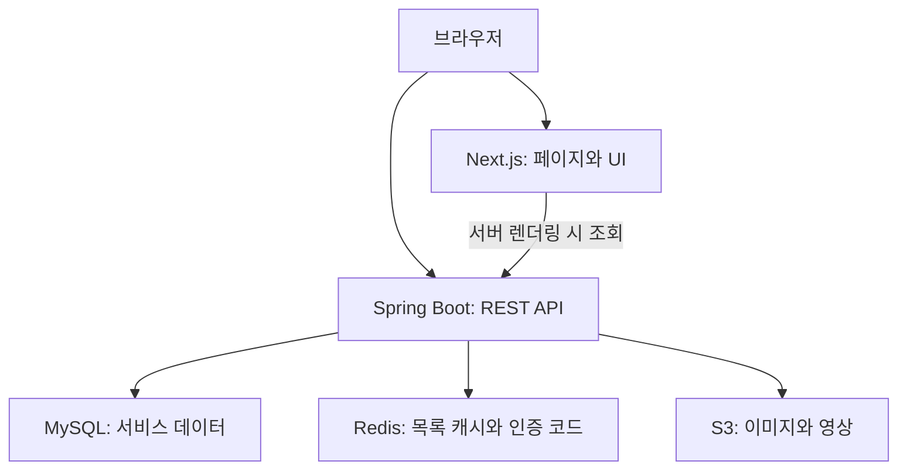

# Next.js + Spring Boot 웹 포트폴리오

> 이력·프로젝트·기술 기록을 관리하는 웹 서비스에 상품 조회, 장바구니, 테스트 결제 흐름을 구현한 개인 프로젝트입니다.

Java와 Spring 기반 웹 개발·유지보수 경험을 바탕으로 API, 데이터 모델, 화면, 인증, 파일 저장, 배포를 직접 연결했습니다. 콘텐츠 관리와 커머스 데모를 통해 **브라우저 → API → DB·캐시·외부 저장소**로 이어지는 요청 흐름을 설명할 수 있도록 구성했습니다.

- 등록된 배포 주소: [swportfolioservices.com](https://swportfolioservices.com)
- 저장소: [KimSunWooo/portfolio](https://github.com/KimSunWooo/portfolio)
- 직무별 코드 안내: [Frontend](#frontend) · [Backend](#backend) · [Full-stack](#full-stack)

## 빠르게 살펴보기

| 확인할 내용 | 화면 | 대표 코드 |
| --- | --- | --- |
| 이력·프로젝트를 API로 조회하는 포트폴리오 | `/`, `/projects/{id}` | [메인 페이지](frontend/src/app/page.tsx), [ResumeService](backend/src/main/java/com/project/backend_api/service/ResumeService.java) |
| 콘텐츠 작성·수정, 이미지·영상 업로드 | `/admin/resume`, `/admin/projects` | [ProjectAdmin](frontend/src/components/admin/ProjectAdmin.tsx), [ProjectService](backend/src/main/java/com/project/backend_api/service/ProjectService.java) |
| 상품 검색·필터와 상세 조회 | `/shop`, `/product/{id}` | [ShopPage](frontend/src/app/shop/page.tsx), [ProductService](backend/src/main/java/com/project/backend_api/service/ProductService.java) |
| 사용자별 장바구니와 비회원 데이터 병합 | `/cart`, `/login` | [장바구니 API](frontend/src/lib/api.ts), [CartService](backend/src/main/java/com/project/backend_api/service/CartService.java) |
| 공지·FAQ·기술 문제 해결 기록 | `/community` | [CommunityPostView](frontend/src/components/community/CommunityPostView.tsx), [CommunityService](backend/src/main/java/com/project/backend_api/service/CommunityService.java) |
| 결제 SDK 연동과 결제·취소 이력 데모 | `/checkout`, `/payment/success`, `/mypage` | [CheckoutPage](frontend/src/app/checkout/page.tsx), [PaymentService](backend/src/main/java/com/project/backend_api/service/PaymentService.java) |

시연 계정으로 관리자 화면을 확인할 수 있습니다. 이 계정은 콘텐츠 변경 기능을 포함합니다. 결제 요청 금액은 프론트엔드에서 **100원으로 고정한 테스트 흐름**입니다.

## 구현 범위

| 영역 | 현재 구현 | 다음 보완 |
| --- | --- | --- |
| 콘텐츠 관리 | 프로필·경력·교육·기술·프로젝트·기술 기록 CRUD | 초안·게시 상태, 수정 충돌 처리, 변경 이력 |
| 인증 | BCrypt, JWT Access Token, HttpOnly Refresh Token 쿠키 | 관리자 API 경로와 권한 규칙 정합성, 토큰 종류·폐기 정책, 인증 복구 대기 |
| 상품 조회 | 검색·카테고리 필터, 판매 상태별 조회, Redis 목록 캐시 | 수정 후 캐시 무효화, 페이지네이션, 캐시 키 정규화 |
| 장바구니 | 사용자 소유 확인, 수량 변경·삭제, 비회원 데이터 병합 코드 | 빈 장바구니 조회, 입력 검증, 중복 병합·동시 요청 처리 |
| 파일 | Multipart 요청, UUID 파일명, S3 이미지·영상 저장 | 요청 DTO 정합성, DB·S3 실패 시 보상 처리 |
| 결제 데모 | SDK 호출, 결제·취소 이력 저장과 취소 요청 코드 | 서버 주문 모델, 금액·소유자·PG 승인 검증, 멱등 처리 |
| 배포 | Docker 이미지 빌드·푸시, EC2 배포 워크플로 | PR 검사, 기능 회귀 테스트, 헬스 체크와 복구 절차 |

상품·장바구니·결제 화면은 서비스 연동을 학습하기 위한 데모 범위입니다. 주문·주문 항목 모델과 재고 예약·차감은 후속 구현 대상으로 관리합니다.

## 기술 구성

버전은 저장소의 `package.json`과 `build.gradle` 기준입니다.

| 구분 | 사용 기술 |
| --- | --- |
| Frontend | Next.js 16.3.0, React 19.2.8, TypeScript, Tailwind CSS 4, Zustand |
| Backend | Java 21, Spring Boot 4.1.0, Spring Security, Spring Data JPA, Bean Validation |
| 데이터·인증 | MySQL, Redis, Spring Cache, JJWT |
| 파일·메일 | Amazon S3 SDK, Spring Mail |
| 실행·배포 | Docker, Docker Compose, GitHub Actions, EC2·RDS 연동 설정 |
| 검증 | TypeScript, ESLint, Gradle/JUnit, k6 스크립트 |

## 요청 구조



브라우저 API 주소는 `NEXT_PUBLIC_API_URL`, 서버 렌더링용 주소는 `INTERNAL_API_URL`로 분리합니다. Docker 내부 주소가 브라우저로 전달되지 않도록 파일 URL은 공개 주소 기준으로 처리합니다.

Access Token은 프론트엔드 모듈 메모리에 보관하고 API 요청의 Bearer 헤더로 전달합니다. Refresh Token은 서버가 HttpOnly·Secure·SameSite=Lax 쿠키로 발급합니다. 전체 페이지 이동 후에는 메모리 토큰이 사라지므로 쿠키를 통한 인증 복구가 필요합니다.

## Frontend

화면 구현과 API 연동을 확인하는 순서입니다.

1. [메인 페이지](frontend/src/app/page.tsx): 서버에서 이력·프로젝트를 조회하고 렌더링합니다. 데이터 조회 실패 시 fallback 데이터를 사용합니다.
2. [상품 상세 페이지](frontend/src/app/product/[id]/page.tsx): 서버 조회 결과를 상호작용이 필요한 [ProductDetail](frontend/src/components/product/ProductDetail.tsx)에 전달합니다.
3. [관리자 프로젝트 화면](frontend/src/components/admin/ProjectAdmin.tsx): 입력 폼, 등록·수정, 미디어 관리 흐름을 구현했습니다.
4. [공통 API 모듈](frontend/src/lib/api.ts)과 [인증 상태](frontend/src/store/useAuthStore.ts): API 주소, 메모리 토큰, 화면 상태를 연결합니다.
5. [장바구니 화면](frontend/src/app/cart/page.tsx): 서버 데이터와 비회원 로컬 데이터를 구분해서 표시합니다.

후속 작업은 인증 초기화의 공통 처리, 요청 취소·응답 순서 보장, API 계약 타입 정리, 오류·빈 상태·로딩 상태 구분, 키보드 접근성과 이미지 성능 검증에 집중합니다.

## Backend

API 경계와 데이터 처리를 확인하는 순서입니다.

1. [SecurityConfig](backend/src/main/java/com/project/backend_api/security/SecurityConfig.java), [JwtTokenProvider](backend/src/main/java/com/project/backend_api/security/JwtTokenProvider.java): 요청 경로별 정책, JWT 발급·검증과 인증 객체 생성 코드입니다. 관리자 실제 경로와 권한 규칙의 정합성은 우선 보완 대상입니다.
2. [CartService](backend/src/main/java/com/project/backend_api/service/CartService.java), [CartRepository](backend/src/main/java/com/project/backend_api/repository/CartRepository.java): 사용자별 데이터 조회, 소유권 확인, 상품 수량 병합과 조회 쿼리를 확인할 수 있습니다.
3. [ProductService](backend/src/main/java/com/project/backend_api/service/ProductService.java), [RedisConfig](backend/src/main/java/com/project/backend_api/config/RedisConfig.java): 카테고리·검색어별 캐시와 10분 TTL, 응답 Wrapper 직렬화 설정입니다.
4. [ProjectService](backend/src/main/java/com/project/backend_api/service/ProjectService.java): 콘텐츠와 파일 저장 흐름을 확인할 수 있습니다.
5. [GlobalExceptionHandler](backend/src/main/java/com/project/backend_api/config/GlobalExceptionHandler.java): 입력 오류와 상태 코드 응답을 처리합니다.

후속 작업은 권한 회귀 테스트, 재시도·동시성·캐시 무효화, 외부 시스템 실패 처리, API 계약 문서화에 집중합니다.

## Full-stack

클라이언트와 서버 사이에서 같은 데이터를 어떻게 전달하는지 확인하는 순서입니다.

| 흐름 | Frontend | Backend | 설명할 설계 경계 |
| --- | --- | --- | --- |
| 콘텐츠 조회·편집 | 메인·관리자 화면 | Resume·Project Controller/Service | 공개 조회와 관리자 변경, 요청·응답 형식 |
| 파일 업로드 | FormData·미디어 폼 | Multipart·S3·미디어 DB | 요청 형식, 파일과 DB 저장 실패 |
| 로그인·장바구니 | 메모리 토큰·Zustand·localStorage | JWT·CartService | 인증 복구, 데이터 소유권, 병합 재시도 |
| 상품 검색 | 검색 폼·목록 UI | 필터 쿼리·Redis 캐시 | 조회 조건, 변경 후 최신성 |

대표 사례를 정리할 때는 **발생 조건 → 요청 경로 → 원인 → 수정 → 회귀 검증** 순서로 기록합니다. 결제·파일 저장처럼 외부 시스템이 포함된 작업은 DB 트랜잭션의 범위와 외부 요청의 성공 여부를 구분해서 설명합니다.

## 개발 과정에서 다룬 문제

| 문제 | 코드에 반영한 접근 | 확인할 파일 |
| --- | --- | --- |
| Docker 내부 SSR 요청과 브라우저 요청의 주소 차이 | 내부 API 주소와 공개 API 주소 분리 | [api.ts](frontend/src/lib/api.ts) |
| 일부 요청의 토큰 조회 위치 차이 | 메모리 Access Token과 공통 헤더 함수 사용 | [api.ts](frontend/src/lib/api.ts) |
| Multipart 업로드 요청 형식 | FormData 전송 시 Boundary를 브라우저에 맡김 | [미디어 업로드 API](frontend/src/lib/api.ts) |
| Redis 응답 역직렬화 | 목록 Wrapper와 Redis용 ObjectMapper 설정 | [ProductListWrapper](backend/src/main/java/com/project/backend_api/dto/product/ProductListWrapper.java), [RedisConfig](backend/src/main/java/com/project/backend_api/config/RedisConfig.java) |
| 메인 포트폴리오의 데이터 갱신 | `force-dynamic`으로 요청 시 렌더링 | [메인 페이지](frontend/src/app/page.tsx) |

이 표는 현재 코드에서 확인할 수 있는 접근을 설명합니다. 각 접근의 실패 조건과 회귀 테스트는 후속 검증 대상으로 관리합니다.

## 실행 준비

### Frontend

Node.js 20 계열의 Docker 빌드 환경을 사용합니다. 아래 명령은 저장소 루트에서 실행합니다.

```bash
cd frontend
npm ci
npm run dev
```

프론트엔드 환경변수:

```dotenv
NEXT_PUBLIC_API_URL=http://localhost:8080
INTERNAL_API_URL=http://localhost:8080
```

Next.js 컨테이너에서는 `INTERNAL_API_URL=http://backend-api:8080`처럼 Docker 서비스 이름을 사용합니다. `NEXT_PUBLIC_API_URL`은 브라우저가 접속할 수 있는 주소이며 이미지 빌드 때 전달됩니다.

### Backend

Java 21, MySQL, Redis와 아래 설정값이 필요합니다. Spring Boot 실행에는 프로세스 환경변수 또는 별도의 설정 주입을 사용합니다.

| 환경변수 | 용도 |
| --- | --- |
| `SPRING_DATASOURCE_URL`, `SPRING_DATASOURCE_USERNAME`, `SPRING_DATASOURCE_PASSWORD` | 개발용 MySQL 연결 |
| `REDIS_HOST`, `REDIS_PORT` | Redis 연결 |
| `JWT_SECRET` | JWT 서명 키 |
| `AWS_ACCESS_KEY_ID`, `AWS_SECRET_ACCESS_KEY` | 현재 S3 설정의 자격증명 주입 |
| `TOSS_SECRET_KEY` | 테스트 결제 API 설정 |
| `GOOGLE_MAIL_PASSWORD` | 현재 메일 설정의 자격증명 주입 |
| `APP_CORS_ALLOWED_ORIGINS` | 프론트엔드 주소; 로컬 예: `http://localhost:3000` |

S3 버킷·메일 발신자 등 일부 값은 [application.properties](backend/src/main/resources/application.properties)에 설정되어 있습니다. 본인의 개발 환경에 맞게 별도 설정으로 덮어써야 합니다.

```bash
cd backend
./gradlew bootRun
```

현재 기본 프로필은 `local`이며, 운영 Docker 이미지는 `prod` 프로필로 실행합니다. 운영 설정은 `ddl-auto=validate`입니다. 새 DB에는 스키마와 시연 데이터 준비가 필요하며, 자동 마이그레이션·초기 데이터 생성 흐름은 아직 포함하지 않았습니다. Refresh Token 쿠키의 Secure 정책도 로컬 실행 방식에 맞게 확인해야 합니다.

### Docker

루트의 `docker-compose.yml`은 frontend·backend·Redis를 실행하며 `.env`를 필요로 합니다. DB는 별도 연결 설정을 사용합니다. `backend/docker-compose.yml`은 별도의 MySQL·backend 실행 구성으로, 루트 구성과 역할이 다릅니다.

실행 전에 DB 스키마, 환경변수, S3·메일 설정을 준비하세요. 현재 저장소는 새 환경에서 한 명령으로 모든 시연 데이터를 생성하는 구성을 제공하지 않습니다.

## 검증과 성능 기록

2026-10-11, 코드 기준 커밋 `7dbc643`에서 확인한 결과입니다.

| 검사 | 결과와 범위 |
| --- | --- |
| Frontend 의존성 설치 | `npm ci --ignore-scripts --no-audit --no-fund` 성공 |
| TypeScript | `tsc --noEmit --incremental false` 통과 |
| Frontend 프로덕션 빌드 | `npm run build` 통과; 로컬 주소를 사용했으며 backend 연동 성공을 의미하지 않음 |
| ESLint | 62개 오류·35개 경고; 타입·Hook·이미지·탐색 규칙 보완 필요 |
| Backend 컴파일 | 검증 미완료; 점검 환경에서 Gradle 배포 파일 다운로드가 차단되었고 설치 JDK는 17 |
| 기능 자동 테스트 | Backend의 `contextLoads` 테스트 1개 포함; 사용자 시나리오 회귀 테스트는 후속 작업 |
| 부하 테스트 | [load-test.js](load-test.js): 상품 목록에 50 VU, 30초, 상태 코드 검사 |

현재 k6 스크립트에는 캐시 적용 전후를 재현할 데이터 크기·DB 상태·측정 결과 파일이 포함되어 있지 않습니다. 성능 비교 자료는 동일 환경에서 캐시 적용 전후의 p50·p95·처리량·실패율을 함께 기록한 뒤 추가할 계획입니다.

## 배포 흐름

[deploy.yml](.github/workflows/deploy.yml)은 `main` 푸시 시 Docker 이미지 빌드·푸시 후 EC2의 배포 스크립트를 호출합니다. Backend Docker 빌드는 `-x test`로 테스트를 생략합니다. 현재 워크플로는 빌드·배포 자동화를 제공하며, PR의 타입·린트·기능 테스트를 필수 검사로 실행하는 구성은 후속 작업입니다.

워크플로가 호출하는 EC2의 `deploy.sh`와 reverse proxy 설정은 저장소에 포함되어 있지 않습니다.

## 다음 구현 순서

1. 관리자 API 권한 매핑과 인증 초기화, 빈 장바구니·미디어 편집 계약 등 핵심 흐름의 오류 수정.
2. 인증·소유권·중복 요청·캐시 최신성·외부 요청 실패를 검증하는 회귀 테스트와 PR 검사.
3. 콘텐츠 초안·게시·수정 버전·변경 이력으로 관리 업무 흐름 확장.
4. 직무별 대표 사례를 코드·테스트·측정 자료와 함께 문서화.
